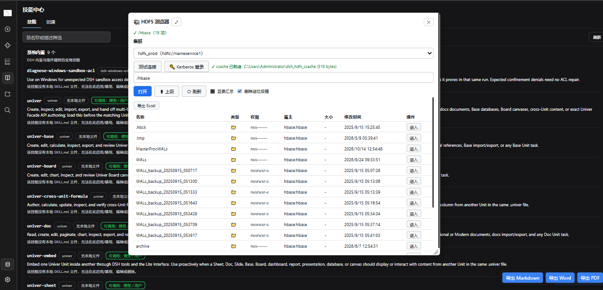

# dsh-hdfs

DeepSeek Harness (dsh) 插件：**在 dsh 里浏览与操作 HDFS**。Rust (napi-rs + hdfs-native) 直连集群，支持 HA 多 Namenode 与 Kerberos，带 Web 浏览面板与 agent 工具。

- 宿主半：`/api/hdfs/*` RPC 路由 + `hdfs` agent 工具
- 浏览器半：设置页 HDFS 面板（目录树 / 文件预览 / 列表排序 / 集群配置 / Kerberos 登录）
- 原生半：`hdfs-native` 0.11 封装，纯 Rust Kerberos（keytab → TGT → ccache）



## 能力

| 分类 | 端点（agent 工具 `hdfs` 的 `endpoint` 同名） |
|---|---|
| 连接 | `version` `clusters` `ping` `kerberosLogin` `kerberosStatus` |
| 浏览 | `list` `status` `read` `findSpecialDirs` |
| 写入 | `write` `upload` `download` `mkdirs` `createEmpty` `rename` |
| 管理 | `delete` `chmod` `getAcl` `modifyAcl` `removeAcl` |

## 从零构建

```bash
npm install                       # 安装依赖（含 @napi-rs/cli）
npm run build:native              # cargo 编 Rust → lib/native/*.node（约 1~2 分钟）
npm run build                     # tsc 编 TS + 包浏览器 bundle
npm run check                     # 三层冒烟：native / plugin / rpc
```

> Windows 上 cargo/napi 需要能正常起子进程的环境（沙箱内会被拦）。
> 若 `.node` 正被 dsh 宿主占用导致 `copyArtifact` 失败：先 `cargo build --release`
> 单独编译，再重启宿主（见 `AGENTS.md`「已知坑」）。

## 安装进 dsh

```bash
npx @deepseek-ai/dsh plugin --profile web add .
# 然后重启宿主（插件集在启动时扫描）
```

## 集群配置

配置载体是 profile 的 `cordis.patch.yml`（也可在「设置 → 插件 → HDFS」里改，volatile 热更新）：

```yaml
- id: hdfs
  config:
    clusters: '[{"id":"prod","url":"hdfs://nameservice1","extraConfig":"{\"dfs.nameservices\":\"nameservice1\",\"dfs.namenode.rpc-address.nameservice1.nn1\":\"nn1-host:8020\",\"dfs.namenode.rpc-address.nameservice1.nn2\":\"nn2-host:8020\",\"dfs.ha.namenodes.nameservice1\":\"nn1,nn2\",\"dfs.namenode.kerberos.principal\":\"hdfs@REALM\",\"dfs.namenode.keytab.file\":\"/path/hdfs.keytab\"}"}]'
    defaultCluster: prod
```

- `clusters` 是 **JSON 数组字符串**，每项 `{id, url, extraConfig}`；`extraConfig` 是 Hadoop 配置的 JSON 字符串。
- `url` 必须是 `hdfs://` 开头；HA 场景填逻辑名（`hdfs://nameservice1`），地址与 namenode 清单由 `extraConfig` 提供。
- 省略 `cluster` 参数时用 `defaultCluster`（留空取第一个）。

### 用户名怎么定（两种互斥路径）

| 场景 | 用户名来源 |
|---|---|
| extraConfig 里有 `dfs.namenode.kerberos.principal` + `dfs.namenode.keytab.file` | principal 的 `@` 前缀（`hdfs@REALM` → `hdfs`） |
| 否则 | 环境变量 `HADOOP_USER_NAME` → `HADOOP_USERNAME` → `HDFS_USERNAME` |

配置里**没有** user 字段，这是刻意设计。

## 使用

### agent 工具

会话里直接让模型操作，例如：

```
列出 HDFS 根目录          → hdfs {endpoint:"list", args:{path:"/"}}
读一个文件的前 64KB       → hdfs {endpoint:"read", args:{path:"/tmp/a.csv", maxBytes:65536}}
找全集群的 .Trash 目录     → hdfs {endpoint:"findSpecialDirs", args:{patterns:[".Trash","staging"]}}
Kerberos 登录             → hdfs {endpoint:"kerberosLogin"}
```

### Web 面板

- 设置 → 插件 → **HDFS**（0.1.7 的 `settings.plugins.tab` 插槽）；
- 插槽不可用时回退为左下角浮动「🐘 HDFS」启动器。

面板功能：集群下拉、路径面包屑、目录表格（权限/属主/大小/时间）、文本预览、目录汇总开关、Kerberos 登录与状态、集群 JSON 编辑与校验；
浏览区工具栏支持**新建目录 / 新建文件 / 上传本机文件 / 勾选删除**（删除默认进 HDFS 垃圾箱，可关闭开关改为永久删除）。
上传在浏览器里读取文件字节，经 `upload` RPC 由宿主中转，单文件上限 200MB。

## Kerberos 说明

1. 首次操作前先 `kerberosLogin`（面板按钮或工具端点）：纯 Rust `kinit-kt` 用 keytab 取 TGT，写入
   `%USERPROFILE%\dsh_hdfs_ccache` 并设置进程级 `KRB5CCNAME`。
2. **ccache 是进程级状态**：宿主重启后要重新登录。
3. SASL/GSS 协商由 `hdfs-native` 经 libloading 调用**系统 GSS 库**：
   - Linux：需要 `libgssapi_krb5.so.2`（MIT Kerberos / Heimdal）
   - Windows：需要 `gssapi_krb5.dll`（MIT KFW），放在 `.node` 同目录或系统路径即可
   - 缺失时报 `GSSAPI error: ... GSS_S_BAD_MECH ...`
4. `KRB5CCNAME` 若被其他工具设成 `API:krb5cc` 这类非文件型值，本插件会忽略它并改用固定文件路径
   （`API:` 型 ccache hdfs-native 解析不了）。

## 安全边界

- 插件 RPC 走 dsh 既有鉴权与会话隔离，`connection.fetch` 的 exact 路由不绕过 `/api` 的信任栅栏。
- keytab 路径是配置项而非密钥本身；keytab 文件不随插件分发，也不入库（`.e2e-cluster.local.json` 已 gitignore）。
- 删除默认进 HDFS 回收站（`delete` 带 `trash:true`）。

## 开发

仓库结构、已知坑与验证矩阵见 [`AGENTS.md`](./AGENTS.md)。

```
rust/           Rust napi 封装（hdfs-native）
src/            TS：宿主半 index/rpc/tool/settings + 浏览器半 client
scripts/        wrap-client（bundle 外壳）+ 三层冒烟 + 真实集群 e2e
lib/            构建产物（gitignore）
```

## 许可

Apache-2.0
